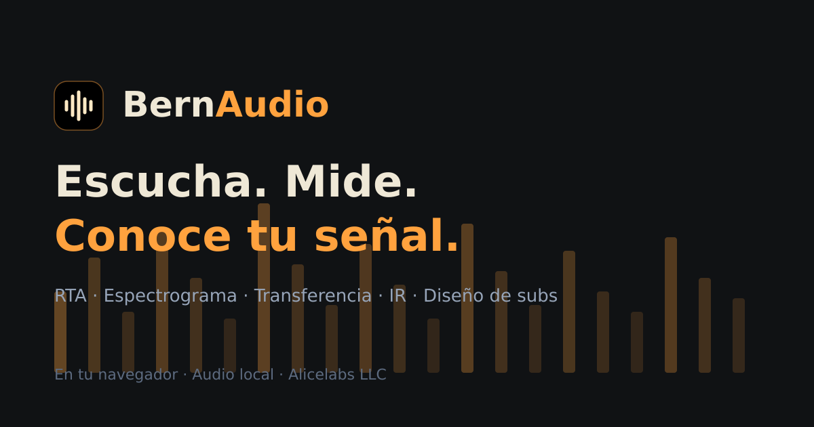

# BernAudio 🎛️

> **Medición y alineación de audio profesional en tiempo real.**
> El análisis de audio profesional, al alcance de todos.

Landing page oficial de **BernAudio** — la plataforma de medición acústica en tiempo real
para diseñar, afinar y monitorear sistemas de sonido en Windows, macOS, Linux e iPad.



## ✨ Características destacadas

| Motor | Descripción |
|-------|-------------|
| **RTA** | 1/1, 1/3 y 1/6 de octava · FFT hasta 128K · promediado espacial |
| **Espectrograma** | Mapa de calor continuo acelerado por GPU hasta 192 kHz |
| **Función de transferencia** | Magnitud, fase y coherencia · doble ventana FFT · MTW |
| **Impulse Response** | LIFFT integrado para delay y análisis de reflexiones |
| **Sync inalámbrico** | Transfer function sincronizada sin cable de referencia |
| **SPL remoto** | Logging multicanal + webviewer en vivo incluido |
| **Asistente IA** | Sugerencias de delay, ganancia y EQ justificadas |
| **Colaboración cloud** | Sesiones multiusuario en tiempo real |

## 🗂️ Estructura del repositorio

```
bernaudio/
├── index.html          # Landing completa (una sola página)
├── css/
│   └── styles.css      # Sistema de diseño dark premium
├── js/
│   └── main.js         # Motores de visualización canvas (RTA, spectrogram, TF)
├── assets/
│   ├── logo.svg        # Logotipo horizontal
│   ├── favicon.svg     # Ícono del sitio
│   └── og.svg          # Imagen para Open Graph / redes sociales
├── 404.html            # Página de error amigable
├── deploy.sh           # Script de publicación automática en GitHub Pages
├── .nojekyll           # Sirve los archivos tal cual (sin procesamiento Jekyll)
└── README.md
```

## 🚀 Publicar en GitHub Pages (elige una vía)

### Vía A — Sin terminal (2 minutos, la más fácil)

1. Descarga **`bernaudio-github-pages.zip`** y descomprímelo.
2. Entra a [github.com/new](https://github.com/new) → nombre **`bernaudio`** → Público → **Create repository**.
3. En la página del repo nuevo, pulsa **«uploading an existing file»** (o *Add file → Upload files*) y **arrastra todo el contenido** de la carpeta descomprimida → **Commit changes**.
4. Ve a **Settings → Pages** → *Branch*: **`main`** + **`/ (root)`** → **Save**.
5. En 1–2 minutos vive en: `https://TU-USUARIO.github.io/bernaudio/`

### Vía B — Script automático (1 comando, hace todo)

```bash
cd bernaudio
bash deploy.sh
```

El script pide tu usuario y un token PAT, y se encarga de **crear el repo,
subir el código y activar GitHub Pages** automáticamente.

> 🔑 Para el token: abre [github.com/settings/tokens/new?scopes=repo](https://github.com/settings/tokens/new?scopes=repo),
> ponle descripción *BernAudio*, marca el scope **`repo`** y genera. Pégalo cuando
> el script lo pida (entrada oculta). El token **no queda guardado** en ninguna parte.

### Vía C — Manual con git

1. Crea el repositorio **`bernaudio`** en GitHub (sin README inicial).

2. Sube el contenido de esta carpeta a la rama `main`:

   ```bash
   cd bernaudio
   git init
   git add .
   git commit -m "feat: landing inicial de BernAudio"
   git branch -M main
   git remote add origin https://github.com/TU-USUARIO/bernaudio.git
   git push -u origin main
   ```

3. Ve a **Settings → Pages**.
4. En *Source* elige **Deploy from a branch**, rama **`main`**, carpeta **`/ (root)`** y guarda.
5. En 1–2 minutos tu landing estará viva en:

   ```
   https://TU-USUARIO.github.io/bernaudio/
   ```

> 💡 El archivo `.nojekyll` ya está incluido para que GitHub Pages sirva
> los archivos estáticos sin procesarlos con Jekyll.

## 🛠️ Desarrollo local

No necesitas dependencias. Cualquier servidor estático funciona:

```bash
# Python
python3 -m http.server 8080

# Node
npx serve .
```

Abre `http://localhost:8080` en tu navegador.

## 🎨 Sistema de diseño

- **Fondo:** `#06080C` (dark premium)
- **Acento principal:** teal `#2DD4BF`
- **Acento secundario:** ámbar `#F5B04C`
- **Tipografías:** Space Grotesk (títulos) · Inter (cuerpo)
- Las visualizaciones del hero, la demo y el CTA son **canvas reales** (RTA, espectrograma y función de transferencia simulados), no videos ni GIFs.

## 📄 Licencia

MIT — ver [LICENSE](LICENSE).
